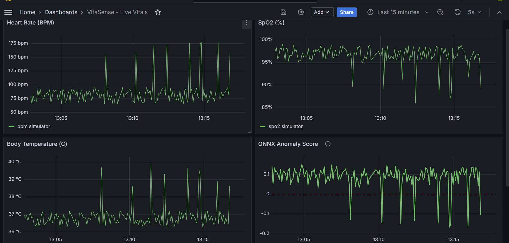

# VitaSense Edge

**Real-Time Biomedical Edge AI & IoT Anomaly Detection System**

VitaSense Edge is an end-to-end IoT and Machine Learning pipeline that streams biomedical telemetry (ECG, Heart Rate, SpO2, Body Temperature) over MQTT, processes it through a time-series database, and performs on-edge anomaly detection using an ONNX-optimized Isolation Forest model. 

## 📸 Live Dashboard

## 🏗️ Architecture

    [ Sensors / Simulator ] -> MQTT (Mosquitto) -> Python Consumer -> InfluxDB
                                                                 |
                                                                 v
                                                ONNX Runtime (Anomaly Detection)
                                                                 |
                                                                 v
                                                    InfluxDB -> Grafana Dashboard

## ✨ Features

- **Data Simulation & Ingestion:** Python simulator mimics an ESP32, publishing JSON telemetry over MQTT every 5 seconds.
- **Message Broker:** Eclipse Mosquitto container receives and routes data.
- **Time-Series Storage:** InfluxDB stores telemetry and ML predictions.
- **Edge AI Inference:** Scikit-learn `IsolationForest` trained on normal vs. anomalous vitals, exported to ONNX for blazing-fast edge inference.
- **Live Visualization:** Grafana dashboard displays real-time vitals, anomaly scores, and a status indicator.

## 🛠️ Tech Stack

- **IoT / Messaging:** MQTT, Eclipse Mosquitto
- **Backend / Data:** Python 3, InfluxDB 2.7, Docker Compose
- **Machine Learning:** Scikit-learn, ONNX Runtime
- **Frontend / UI:** Grafana 10.4

## 🚀 Quick Start

**1. Start the Infrastructure (Docker)**
    docker compose up -d

**2. Install Python Dependencies**
    python -m venv .venv
    .\.venv\Scripts\Activate.ps1
    pip install -r requirements.txt

**3. Run the Pipeline (in 2 separate terminals)**

*Terminal A (Consumer):*
    python consumer\mqtt_to_influx.py

*Terminal B (Simulator):*
    python simulator\publish_fake_vitals.py

**4. View the Dashboard**
Navigate to [http://localhost:3001](http://localhost:3001) (admin / vitasense_grafana_2026)

## 📂 Repository Structure

- `consumer/` - Python script that bridges MQTT to InfluxDB and runs ONNX inference.
- `simulator/` - Python script that generates fake biomedical telemetry.
- `ml/` - Training scripts, ONNX export, and the final `.onnx` model.
- `docs/` - Architecture diagrams, screenshots, and Grafana dashboard JSON.
- `docker-compose.yml` - Infrastructure definition (Mosquitto, InfluxDB, Grafana).
